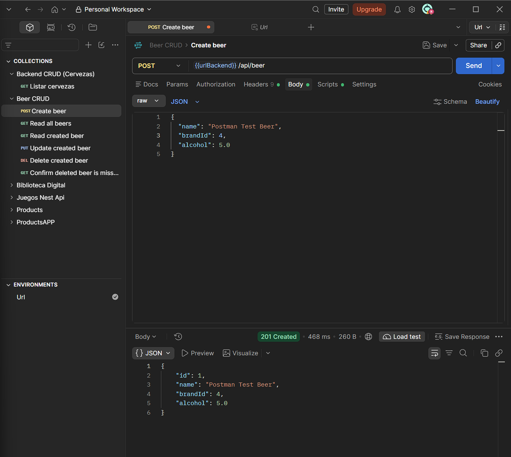
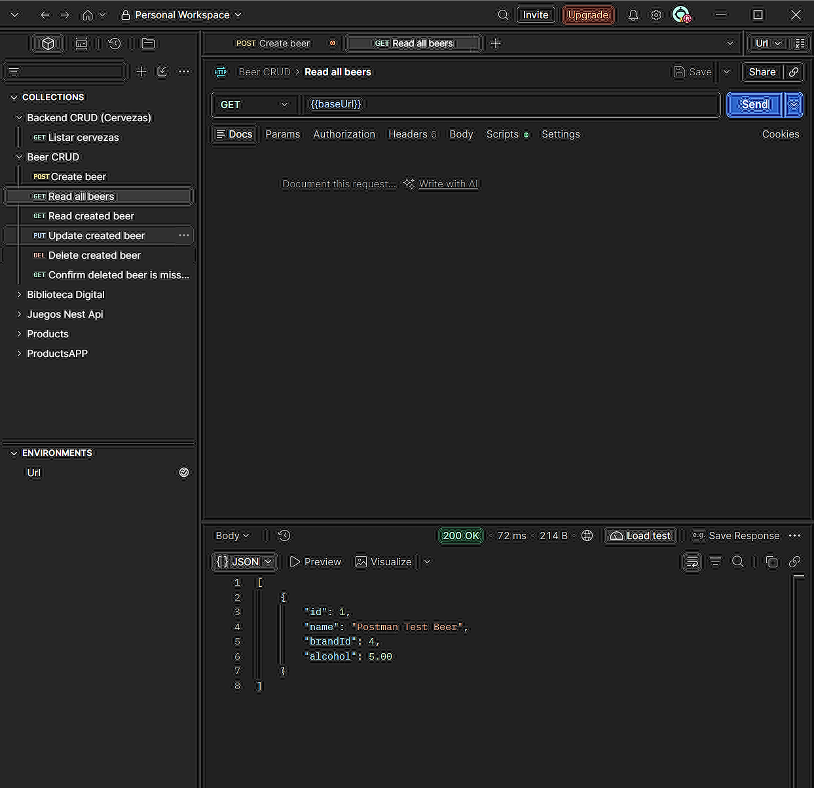
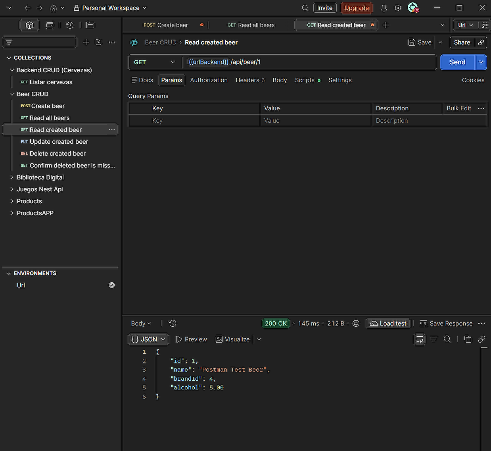
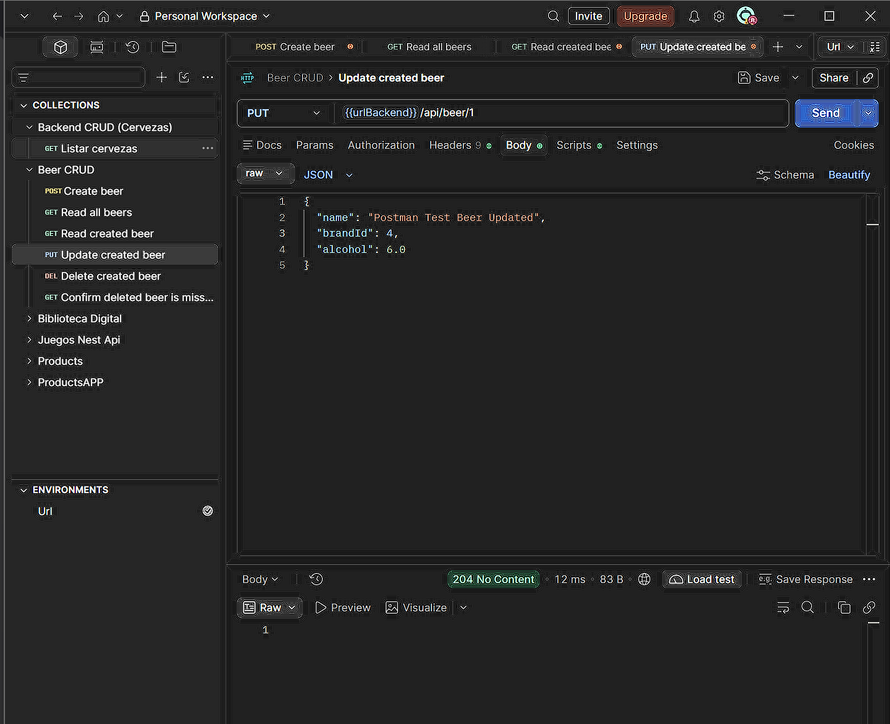
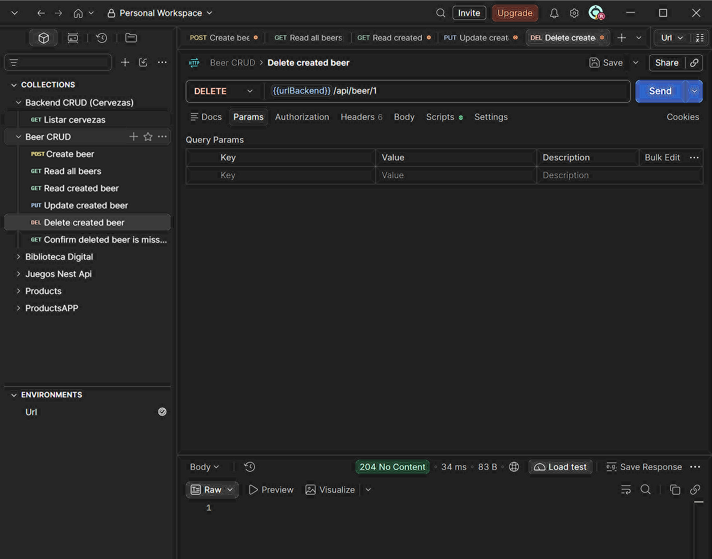
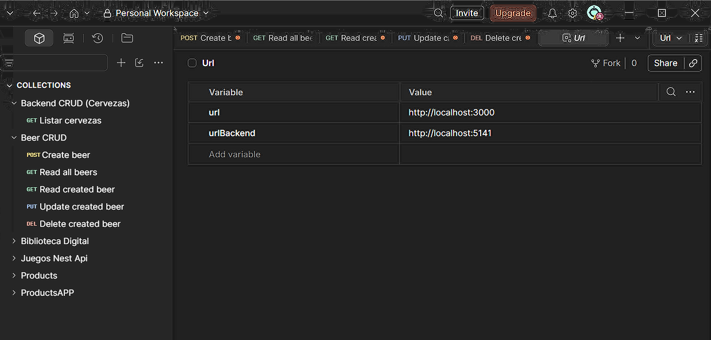

Practica: Backend API REST con .NET y SQL Server

Se realizaron las pruebas de las operaciones CRUD desde Postman y se comprobó la persistencia de datos.

Pruebas de funcionamiento en Postman

A continuacion se muestran las capturas de pantalla de las peticiones realizadas a los endpoints:

1.  Insertar nueva cerveza (POST)
    Peticion enviada con metodo POST enviando el nombre, porcentaje de alcohol y el id de la marca en formato JSON.

2.  Consultar todas las cervezas (GET)
    Peticion enviada con metodo GET para obtener la lista completa de los registros almacenados en la base de datos.

3.  Consultar cerveza por id (GET)
    Peticion GET pasando el id en la URL para recuperar un solo registro especifico.

4.  Actualizar cerveza (PUT)
    Peticion enviada con metodo PUT enviando el id del registro a editar y los nuevos datos a modificar.

5.  Eliminar cerveza (DELETE)
    Peticion con metodo DELETE pasando el id de la cerveza para retirarla de la base de datos.

Como ejecutar el proyecto

1. Abrir la terminal en la carpeta del proyecto.
2. Asegurarse de tener el servicio de SQL Server corriendo y la base de datos `StoreDb` disponible.
3. Ejecutar el comando:

dotnet watch run
